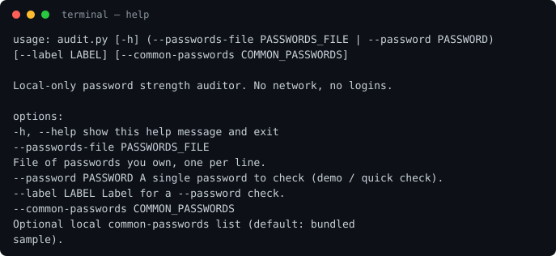
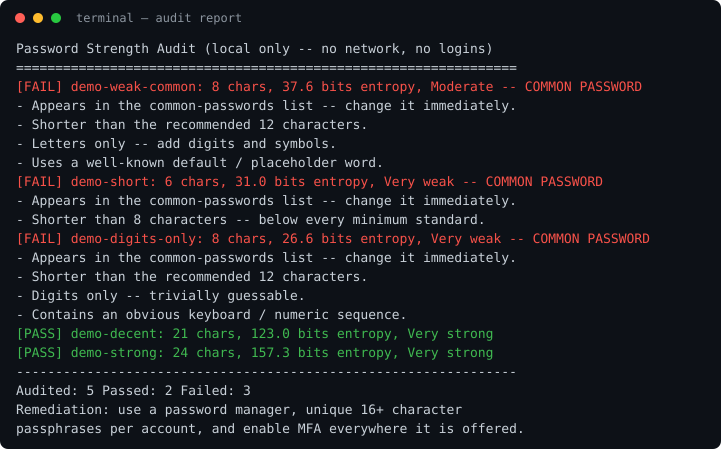

# password-strength-auditor

> **Authorised use only.** Audit only passwords you own. Never use this
> tool — or any password list — to guess, test, or log in to someone
> else's account. That is illegal in most jurisdictions and violates the
> terms of every service.

A local-only password strength auditor. You give it passwords **you own**,
it checks them against a small local list of common passwords, estimates
their entropy, and reports weak passwords with specific, actionable
findings — entirely offline. It makes **no network calls** and never tries
to log in anywhere.

This repo was reframed from an Instagram brute-force script into this
auditor. All live-login behaviour is removed: no browser automation, no
`instagram.com`, no credential submission of any kind.

## What it does

- Checks each password against a local common-passwords list
  (`data/common-passwords-sample.txt` — a small demo sample, clearly
  labelled; supply a proper offline list with `--common-passwords` for a
  serious audit).
- Estimates entropy (bits) from length and character classes used.
- Flags: common password, too short (< 8, or < the recommended 12),
  digits-only, letters-only, repeated characters, obvious sequences.
- Prints a report that **never contains a password** — only labels,
  lengths, entropy, strength bands, and findings — so the report is safe
  to share or file.
- Exits non-zero if any password fails, so it can gate a script or CI step.

## Layout

```
audit.py                    -- thin wrapper: python3 audit.py ...
src/password_auditor/
  __init__.py  __main__.py  -- CLI entry point
  entropy.py               -- entropy estimate + strength bands
  common_passwords.py      -- local common-password list loading
  auditor.py               -- per-password checks, AuditResult
  report.py                -- plain-text report (no passwords in it)
data/
  common-passwords-sample.txt   -- demo sample of common passwords (local testing only)
  sample-passwords-to-audit.txt -- FAKE demo passwords to audit
tests/test_auditor.py      -- stdlib unittest suite (incl. a no-network check)
docs/                      -- captured terminal output from real runs
```

Requirements: Python 3.10+, standard library only. No dependencies.

## Quick start

```bash
# Audit the fake demo passwords
python3 audit.py --passwords-file data/sample-passwords-to-audit.txt

# Check a single password (demo / quick check)
python3 audit.py --password 'Tr0pic@l-River-88-Mango!' --label my-demo

# Audit your own passwords from a file you keep locally (label:password per line)
python3 audit.py --passwords-file ~/my-passwords-to-audit.txt

# Use a larger local common-passwords list
python3 audit.py --passwords-file data/sample-passwords-to-audit.txt \
    --common-passwords /path/to/local-common-list.txt

# Run the tests
python3 -m unittest discover -s tests -v
```

**Do not commit real passwords.** Keep any file of your own passwords on
your own machine, outside this repo.

## What a run looks like

Help output:



Audit report for the demo file (5 entries: 2 pass, 3 fail):



## How password policies, MFA, and lockout defeat brute force

This is the defensive point of the tool — the attack it replaces only works
when all of these are missing:

- **Account lockout / rate limiting** — limit login attempts per account
  and per IP, with escalating delays. Guessing becomes impractical after
  a handful of tries, however good the wordlist is.
- **Multi-factor authentication (MFA)** — even a correct password is not
  enough on its own. MFA is the single most effective defence against
  credential attacks; enable it everywhere it is offered.
- **Strong, unique passwords** — a password in a common list is the first
  thing an attacker tries. Use a password manager, unique 16+ character
  passphrases per account, and never reuse passwords across sites.
- **Breach monitoring** — check whether credentials have appeared in known
  breaches (e.g. Have I Been Pwned, used offline via hash ranges) and
  rotate them if they have.
- **Anomaly detection** — alert on logins from unusual locations, devices,
  or at unusual volumes, and on password-spray patterns (many accounts,
  few passwords).

## What a defender should check

- Login endpoints enforce per-account and per-IP attempt limits + lockout.
- MFA is available and, for privileged accounts, required.
- Password policy requires length (12+ characters) over complexity theatre,
  and rejects passwords found in breach / common lists.
- Failed-login telemetry exists and is alerted on (spray detection).
- No password is ever logged, and audit reports never contain passwords
  (this tool's report upholds that by construction).

## What changed

Reframed from `instabrute` (`instagram-brute-force.py`, which drove a
browser to try passwords from `dictionary.txt` against instagram.com)
into this auditor. Deleted: `instagram-brute-force.py`, `dictionary.txt`,
and `requirements.txt` (which pulled in browser-automation packages
`webbot`/`pynput`). Git history still contains them (see note below).
New name: `password-strength-auditor` — rename the repo in GitHub
Settings → General → Repository name (GitHub redirects the old URL
automatically).

> **History note:** the old brute-force code still exists in earlier git
> history. The connector used here cannot rewrite history / force-push a
> purged history. If you want it gone entirely, rewrite history locally
> (`git filter-repo` / `git filter-branch`) and force-push from a machine
> with git access, or contact GitHub Support. Do not share the old commits.
